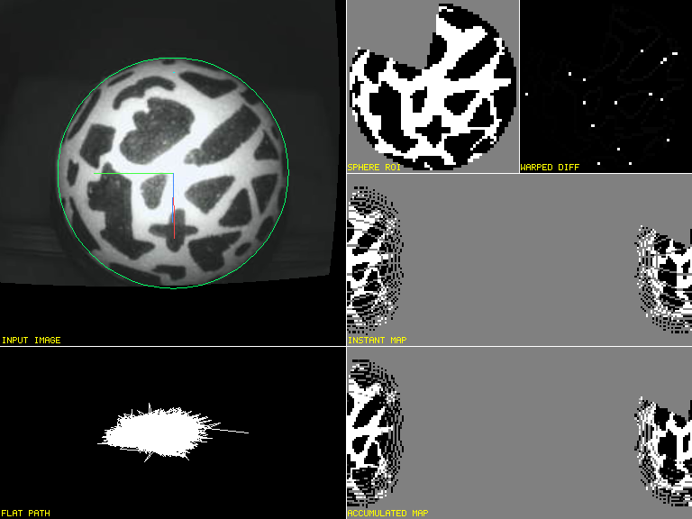

# Learning a partial atlas and refining later passes

Resilient spherical tracking (`rust_resilient : y`) can use the previous
accepted image to retry an uncertain fit before accepted motion history has
accumulated. The retry retains the configured search window and optimizer
budget, spatial agreement checks and every final acceptance gate. It does not
wait for a complete sphere map. Separate appearance-limit exceptions still
require the established motion evidence described in [recovery](recovery.md).

The persistent atlas also remains revisable. Previously, confidence values of
0 and 255 became permanent, so a mistaken early marking could survive every
later pass. Eight eligible contrary observations from views separated by at
least 0.08 rad can unlock a saturated cell after a genuine revisit: its material
normal must have faced away from the camera during accepted tracking, then
be observed again. Repeated images and a first sweep alone cannot overwrite
the anchor. Agreement clears pending contrary votes; multiple projections
from the same image cannot supply multiple confirmations. Revision also needs
at least three of the four adjacent ROI pixels to agree, and the preceding
accepted image, warped by the measured increment, to agree within 0.1 normalized
binary intensity. Every ROI sample landing in the same atlas cell must also
agree; a first colliding sample cannot outvote the rest. Unsupported observations
defer revision. Established labels are revised only when measured rotation is at most one atlas-longitude step
(`2π / map_width` radians per image). Faster views may still learn unseen
surface; an established label waits for a slower revisit so repeated exposure
smear cannot masquerade as reliable material evidence. Unlocked cells
receive at most one confidence update per teaching image. Young revision uses
four-value increments with the existing young-neutral consolidation bonus;
mature revision uses one-value increments. Mature cells retain their sixteen-image contrary-update phase. Learning freezes and new-surface-only
probation still protect established cells, and legacy opt-out keeps its old
confidence behavior.

A continuous acceleration may also establish a new rate after three independently
verified visible increments spanning four images. All three need the existing
distributed temporal support. One acceleration is fitted to the three velocities
at their capture-interval midpoints. Each component's residual is bounded by
`0.006 / interval_ms + 0.35 × median_speed`; fitted speeds must increase and
adjacent fitted direction cosines must be at least 0.75. This avoids
requiring pre-turn stationary jitter to be part of the ramp. The previous
longer-history route remains available; an isolated jump, unverified pair,
direction change or rejected interval cannot use the new route.
The fit only confirms the current measured increment; it does not smooth,
replace or invent published motion.

Broader recovery searches are eligible every six missing-frame positions,
instead of every thirty. Uninformative images still fail before fitting.
Search and confirmation remain bounded; this tries fresh usable evidence
sooner without promising a particular recovery time.

The optimizer, exported template and displayed accumulated map use the same
committed atlas. Rejected images cannot teach it. These changes do not reset
pose or path, substitute a temporal error for the reported persistent-map MSE,
or reconstruct relative motion across a missing interval.

## Controlled regressions

The November 5 recorded-clock follow-up preserves the 8/12 ms intervals reported
by the live cameras. Increasing visible angular steps can now reach the existing
four-image acceleration fit even when those intervals reverse two raw rates.
Fitted speeds must still increase with the same residual and direction checks.
An isolated jump cannot establish an epoch. The uncertain-fit retry uses the
sum of bilinear known-support proposals from both the persistent and previous-image
maps. Its final binary score and all acceptance checks retain their original meaning.

`crates/fictrac-core/tests/recovery.rs` adds two numerical cases, using the
existing deterministic 180×90 material pattern, 160×160 camera geometry and
unchanged 0.008 rad/component RMS gate:

- Five cold starts at 0.04, 0.08, 0.12, 0.16 and 0.20 rad/image begin with a
  nine-sample blurred exposure spanning 1.5 image intervals. Each has only
  that initial view before 39 sharp moving images. All 195 relative increments
  must be measured; a fully learned atlas or stationary warmup is absent.
- A 24×24 textured defect in the first view is consolidated over 100 stationary
  images. Then 700 clean images rotate at 0.02 rad/image, revisiting the surface
  over 2.23 turns. The test requires continuous measurement, correction of at
  least 80% of initially saturated opposite-label cells, and the existing
  motion-accuracy gate. It measures map correction separately from motion.

The confidence tests additionally reproduce the old permanent-lock failure,
verify both confidence extremes, reject duplicate-image confirmations, clear
transient vote streaks and imported/reset history, and verify that mature cells
resist 300 contrary images while remaining revisable over sustained evidence.
Existing acceleration, partial-mask, long-occlusion, capture-gap and rejected-map
invariance tests remain in force.

The live snapshot uses the current 47° M03 calibration. Airflow jitter only
shows part of the surface; gray remains unknown. The visible patch crosses the
equal-area map's longitude seam, so it appears at both horizontal edges.
[Native M01 cold-recording capture](images/atlas-live-M01-20261104.png).
[Three-second native M03 atlas screen recording](images/atlas-live-native-20261104.mp4)
shows the updated build with all four physical cameras running.

The final build also passes the full original high-speed video gates, a
six-minute four-camera run spanning calibration cycles, and exact live/file
replay from four empty-atlas initializations over 8,162 images.
[Numerical, hardware and UI evidence](validation.md#progressive-atlas-learning-and-early-confirmation--2026-11-04)
records the timing tails and measurement limits.

## Scope

The controlled defect has independent orientation information in the rest of
the image. This does not establish safe recovery from every textured hand,
incorrect calibration or unrelated pattern. Known-motion synthetic evidence,
full real-video comparisons and physical-camera airflow jitter answer different
questions. The previously retained 6.608-second M02 hand-recovery gap remains
historical failure evidence; a fresh cold replay does not recreate its exact
initial live atlas. [Validation](validation.md) records the current measured
results and their limits.
