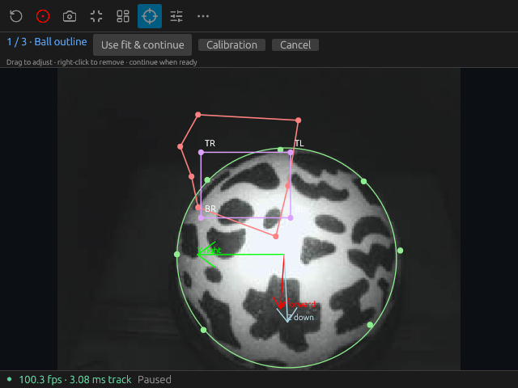

# v0.3.6 — progressive atlas learning and responsive calibration

*Historical local preparation, superseded by [v0.4.0](release-v0.4.0.md).*

The atlas can now refine confident cells on later supported revisits, while
protecting its anchors during a first sweep and rapid/blurred motion. Early
consecutive-image fitting and verified acceleration confirmation reduce false
gaps without raising image-error limits or changing reported motion.
All **343 workspace tests** and the complete original high-speed video gates
pass. [Atlas learning and limitations](atlas-learning.md) ·
[Current numerical validation](benchmarks/atlas-learning-final-20261104.json).

The updated build passes six minutes on all four live 47° cameras at
100.87–100.93 processed frames/s, four calibration cycles and **8,162-image
live/file parity from empty-atlas initialization**. Real native input checks
include manager minimize/restore, all four ball drags, magnifiers, resize and a
closed root window; maximum measured button response is **71.23 ms**.
[Complete evidence and measured preview-age tails](validation.md#progressive-atlas-learning-and-early-confirmation--2026-11-04).

Current atlas-build captures:
[M01 live cold recording](images/atlas-live-M01-20261104.png) ·
[M03 saved outline and atlas](images/atlas-live-debug-M03-20261104.png) ·
[Three-second live native atlas screen recording](images/atlas-live-native-20261104.mp4).

The minimized-rig-manager freeze is reproduced and corrected: the old OpenGL
path took about **2.6 seconds** to paint a button response; the hardware-Vulkan
build stays below **50 ms** in the recorded-input regression cases. Real native
pointer tests include all four ball-outline drags, magnifiers, resize and a
hidden root window. **334 workspace tests** pass. [Root cause and evidence](ui-rendering.md).
The earlier live captures below predate this graphics-policy correction.

Earlier calibration-build live captures:
[M01](images/edit-M01-20261104.png) · [M02](images/edit-M02-20261104.png) ·
[M03](images/edit-M03-20261104.png) · [M04](images/edit-M04-20261104.png) ·
[Three-second live native screen recording](images/live-native-20261104.mp4).
These use the connected cameras; the replay captures below remain separately labeled.

Live camera acquisition continues draining during a calibration hold. Resuming
uses fresh images and explicitly reanchors tracking after discarded frames,
retaining the atlas and accumulated motion without inventing motion across the
gap. Exact serial bindings fail closed when missing or ambiguous; link/unlink
preserves the opened physical camera. Image age is visible beside the FPS rate.

Saved ball marks now select from the original pointer press, fixing fast drags
that previously missed the mark. Calibration offers a direct Edit action. The
M01–M04 rig files use the owner's **47° vertical FOV**, with angular sphere
geometry refitted at 320×240. M03's misplaced historical rim marks were replaced
using the retained real camera image. Existing lab orientation and exclusions
remain physically unverified after this refit.

[M01](images/calibration-47-M01-20261104.png) ·
[M02](images/calibration-47-M02-20261104.png) ·
[M04](images/calibration-47-M04-20261104.png) ·
[Calibration controls](images/calibration-controls-20261104.png) ·
[Native screen capture of recorded camera replay](images/native-camera-replay-20261104.mp4).
These November 4 captures use the retained real 100 FPS camera recordings,
ordinary NV136 Mesa graphics and the native app. A subsequent **fresh live
six-minute 47° run** also passes all four calibration, pause/resume, reopening
and recording checks at 100.88–100.92 processed FPS per camera. See
[fresh hardware validation](validation.md#fresh-four-camera-47-hardware-run--2026-11-04).

The separate hand-driven test exposes an **unresolved 6.608-second M02 recovery
gap**, including clear frames after the hand leaves. It later recovers. This
release preparation does not claim that hand recovery is fixed.

All four complete retained camera takes also process with the new 47° fits:
**1281 images**, four initialization rows and **1277 tracked rows**, with no
rejections. Airflow jitter supplies observed motion, without physical ground
truth. [Calibration evidence](benchmarks/calibration-47-20261104.json) retains
the pixel points, angular fits and exact native binary hash.

Required checks pass: formatting, strict locked workspace/all-target Clippy and
**343 workspace tests** (zero failures or ignored tests). The release synthetic
demo and real sample pass; existing scientific tolerances and oracles are unchanged.

Preview-image age was **27.11 ms median**, **44.92 ms p95**, **48.86 ms maximum**
in the earlier sustained hardware run. The maximum occurred after 82.78 seconds,
not just at startup. Read the [timing definitions and cadence explanation](preview-age.md)
before interpreting these relative measurements as sensor-to-screen latency.

The [optional camera appendix](../book/src/appendix-cameras.md) identifies the
OV9281 Arducam hardware family, global shutter, lens/mount qualifications and
Windows serial-number programming instructions. Ordinary webcams can also be
used. The [multi-camera configuration guide](../book/src/configuration.md#optional-camera-binding)
explains binding independently of USB enumeration order.

Publishing native release assets remains pending GitHub authentication. This
document describes local validation; it is not evidence of a published release
or native execution on other operating systems.
