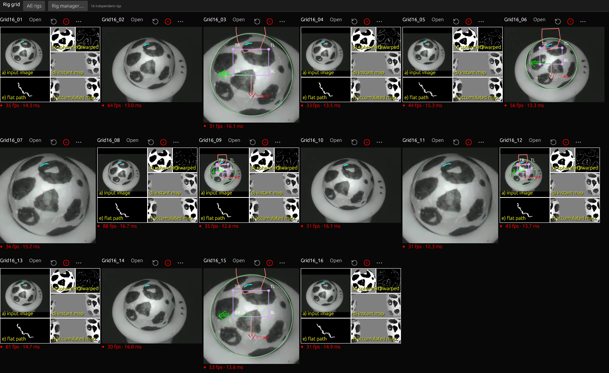
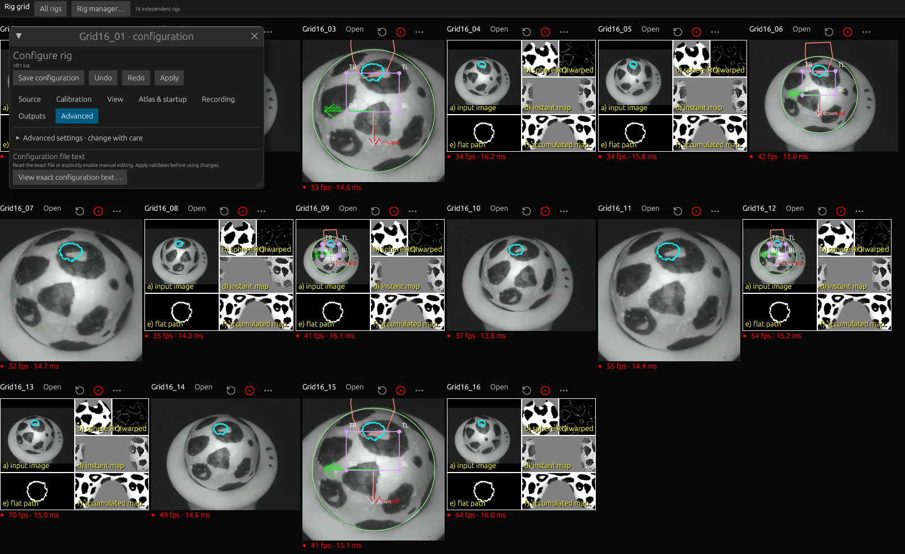
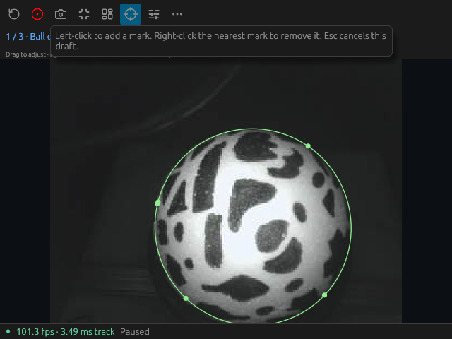
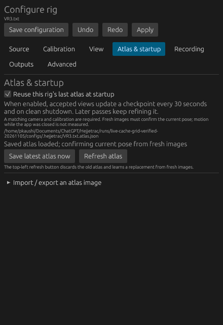
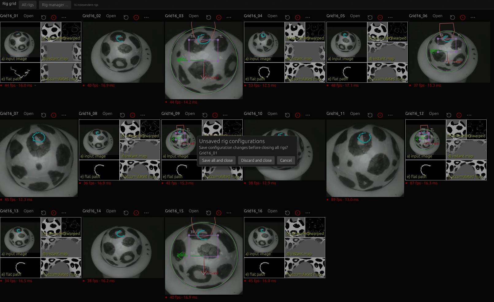

# v0.4.0 — high-speed tracking and saved workspaces

This minor release corrects a live-clock acceleration rejection and improves
uncertain image fitting using both the previous image and persistent atlas.
It also includes the minimized-rig-manager GPU fix, editable 47° calibration,
exact M01–M04 camera bindings, saved workspaces and optional atlas reuse.

The newest 9,339-image M02 recording measures **9,330 of 9,338 possible motion
steps**. Its longest unmeasured interval falls from **1.28 seconds to 80 ms**.
The formerly failing 350-image clear fast-spin section is continuously tracked.
The recording's 47° geometry, quality six and 50-evaluation limit are retained.
[Recorded-clock reproduction and limitations](recorded-clock.md).

All original numerical gates pass: the synthetic demo, complete sample, complete
5,157-image VR3, 6,075-image 47° take, and complete/controlled-omission versions of
the 4,579-image fast take. All **410 VR3 fast images**, **337 post-hand images**
and **3,413 clear fast images** in the older 47° take remain measured. Missing
motion stays explicitly unmeasured. **351 Rust tests**, formatting and strict
Clippy pass. [Exact fixtures, hashes and boundaries](benchmarks/tracking-workspace-ui-20261105.json).

The full newest take has rotation-component RMS agreement with original FicTrac
of **0.00967 / 0.00859 / 0.01442 rad**, including every quality decision. A short
129-image diagnostic window still has Z RMS **0.02054 rad**, above the existing
0.020 target. The clip also retains one 80 ms recovery interval. These results
do not establish physical motion ground truth, universal obstruction recovery
or complete long-trajectory parity. [Full before/after evidence](benchmarks/recorded-clock-20261105.json).

The settings menu now uses explicit sections and flat actions. Moving down the
menu cannot expand recording controls over the pointer route. Exact config text
opens read-only and requires deliberate editing/application. Grid arrangement
fits image aspect ratios and accounts for Linux dock/title-bar space. Saved
full/cropped/debug views return with each rig. Arrays of five to sixteen rigs
share one hardware-rendered grid surface, with embedded settings and rig manager.
This avoids the reproduced XWayland/Nouveau abort from many native presentation
surfaces; the independent tracking workers and outputs are retained. Choose
**Open** to expand a tile and **Grid** to return.

Use the rig manager to add saved configurations and save the current rigs as the
startup workspace. Ordinary graphical launch can restore up to sixteen rigs.
Opt-in atlas reuse checkpoints accepted appearance every thirty seconds and on
clean shutdown. Fresh images must confirm a saved pose. The top-left refresh
arrow discards the old atlas and builds its replacement on later passes.
[Complete graphical manual](../book/src/workspaces.md).

On Debian/Ubuntu, install the downloaded file with the graphical package manager
or `sudo apt install ./hejjetrac-linux-amd64.deb`, then launch **HejjéTrac** from
the applications menu. Linux packages target Ubuntu 22.04/glibc 2.35 or newer.
The app uses native hardware graphics when available. Platform builds and Linux
package-runtime checks gate release publication; local physical-camera execution
is Linux-only.

The [optional hardware appendix](../book/src/appendix-cameras.md) identifies the
compact OV9281 Arducam board family, global shutter, mounting and lens details,
and Windows serial-programming instructions. A suitable regular webcam also
works. [Multi-camera setup](../book/src/rigs.md) explains independent calibration,
serial links and output ports.

The final sixteen-rig native test processes **82,512 source images** in total.
Every accepted UDP stream matches its serial VR3 reference; all sixteen views
restore from ordinary graphical launch. Native input remains below **59 ms**,
with one Intel Vulkan presentation surface and **319.31 MiB** peak observed app
RSS. File replay slows under this load; this is not a sixteen-camera 100 FPS
capacity claim. [Exact stress-test evidence](benchmarks/ui-grid-20261105.json).

Four physical M01–M04 cameras also pass native calibration drags, magnifiers,
manager minimize/restore and closed-root checks, with **44–59 ms** actual pointer
response. Cold/cached live phases sustain **100.72–101.17 FPS** per rig and
verify that refresh replaces the saved atlas without editing calibration text.
Relative preview age is **27.06 ms median / 46.34 ms p95 / 112.90 ms maximum**.
The maximum occurs during steady state and returns to normal at the next sample;
50 ms is not a guaranteed ceiling. [Timing and limits](preview-age.md).

[Watch the four-second native sixteen-rig screen capture](images/grid-sixteen-20261105.mp4).
Closing the first grid rig releases its source/output resources while its peers
continue; closing the whole grid retains unsaved text behind a save/discard/cancel
prompt. Both paths are checked on the actual native window.

Source builds now use HejjéTrac names throughout: `hejjetrac-core`,
`hejjetrac-io`, `hejjetrac-camera`, `hejjetrac-control`, `hejjetrac-cli` and
`hejjetrac-desktop`. The compiled executables are `hejjetrac` and
`hejjetrac-cli`; MCP exposes `hejjetrac_execute`. macOS application identity,
camera-permission text, diagnostic labels and CI artifacts use HejjéTrac too.
Upstream attribution, comparison fixtures and historical benchmark hashes retain
their original names. The Mac/Windows strict-Clippy failure was an X11-only
presentation function included in non-Linux tests; it is now compiled only for
Linux, without relaxing warning checks.
