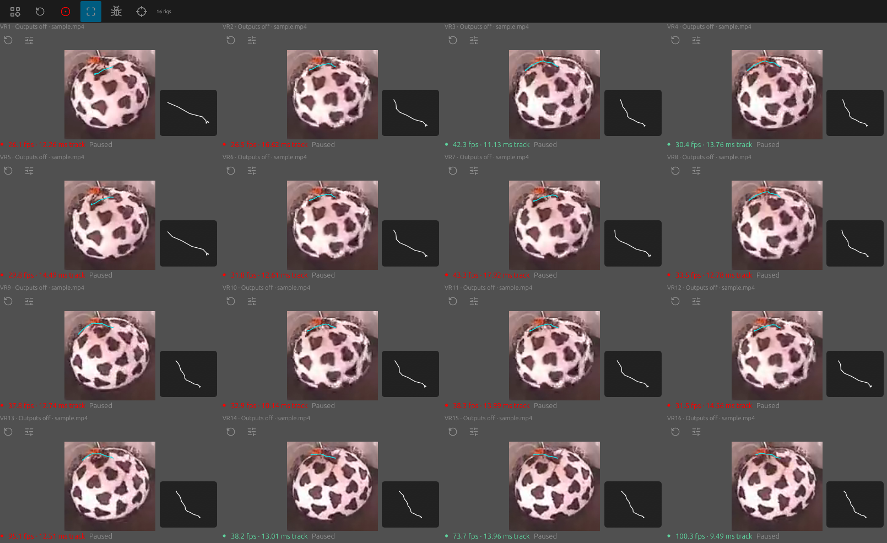

# v0.5.0 — remote recording, frame clocks and portable defaults

Hejjetrac can run tracking on one computer while a VR computer starts and stops
its recordings. Launch the desktop with `--control-bind 0.0.0.0:17871` and use
its per-launch bearer token from Rig Manager. Typed commands control individual
rigs or all active rigs. Ordinary launches retain loopback-only control.
[Exact commands and polling](remote-recording.md).

Takes accept experiment/trial IDs, a trigger ID/time and up to 32 tags. New
desktop/headless recordings and CLI tracking runs include `recording.json`,
`frame-times.csv` and `recording-events.jsonl`. The ledger retains every numeric
row's source and emitted times, host UTC, monotonic interval and available source
sequence/capture estimate. Desktop source events identify the actual opened
camera. Stop is sampled on the worker before encoder finalization. File replay
does not invent original camera wall time. These records support manual joining
with VR logs; they do not establish simultaneous shutters or submillisecond
exposure synchronization. [Clock semantics](remote-recording.md#manual-synchronization-and-clock-limits).

A fresh installation starts one unbound camera. Four portable rig defaults
contain no camera serial, USB socket, user path or fixed capture format. First
copy assigns actual enumerated device numbers, including Linux gaps. The
centered ball outline, default lab rotation and 45-degree FOV are preview
placeholders: calibrate each physical rig. Existing saved configurations and
workspace restoration remain authoritative. Historical calibrated lab examples
are separate from the installed defaults. [Rig setup](../book/src/rigs.md).

Binding edits refresh worker state and camera ownership before committing.
Selecting a camera that is still opening retains that worker; unlink adopts the
actual opened device number. Busy/missing/duplicated bindings and failed command
queues preserve the working document and source. The GUI link button uses the
opened stream's verified identity rather than a stale camera-list entry.

Package, executable, asset and current website/repository names consistently use
`hejjetrac`. New packages ship `hejjetrac` and `hejjetrac-cli` without alternate
command aliases. Earlier GitHub release titles, notes and download labels have
also been corrected. Their original archive bytes and source tags remain
preserved and can contain historical internal filenames.

Ubuntu's package title, summary and description use ASCII **Hejjetrac**. The
installer includes a detailed description, author/license/project/manual/issue
links, the application icon, AppStream screenshots and local screenshot copies.
The desktop identity groups windows with the installed icon. A software center
may choose not to display AppStream images for a standalone `.deb`; the metadata
does not claim a signed or store-reviewed publisher. If an older package has a
different package identity, remove that installed application before installing
the renamed package, preserving saved experiment files. [Installation](../book/src/install.md).

Tracking algorithms, error metrics, numerical gates, decoder oracles, legacy
wire columns and missing-motion decisions are unchanged. [Validation evidence
and platform limits](validation.md#remote-recording-portable-defaults-and-binding-stress--2026-11-07)
separate Linux real-video/native UI tests from untested physical hotplug and
cross-computer exposure timing.

Local validation passes 367 Rust tests, strict Clippy/formatting, 50 Python
checks, 3,068 manual/site links, the release synthetic/demo gates, 80 LAN-triggered
recordings and 16 additional native rig recordings. Native Windows, macOS and
Ubuntu package jobs are the separate release gates; their camera/GUI hardware
coverage remains limited as documented.
