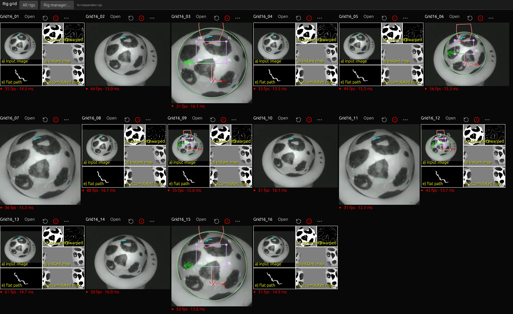

# Rig-manager minimize freeze: reproduction and fix

## Large-array XWayland crash — 2026-11-05

Creating sixteen native rig surfaces on the tested hybrid-GPU desktop also
exposed a separate display-server failure. The app selected Intel hardware
Vulkan, but XWayland aborted in Nouveau with `nouveau_pushbuf_data: Assertion
kref failed`. Every client of that X server, including ChatGPT, lost its
connection. The journal does not show an out-of-memory kill for these failures.
The earlier four-window checks did not establish sixteen-window safety.

Arrays of five to sixteen rigs now share one native hardware-rendered surface.
Tiles, the manager and settings use that surface; each source, numerical worker,
clock and output stays independent. Up to four rigs keep the previously tested
native windows. **Open** expands a tile and **Grid** returns to all rigs. Native
calibration retains the shared source-space editor. No CPU graphics substitution
or machine-wide driver configuration is required.

A bounded five-rig test passed first. Three complete sixteen-file runs pass;
the following figures describe the final release binary. The complete sixteen-rig test then decoded
all **5,157 VR3 images per rig**, with each **5,042-row accepted UDP stream
byte-identical** to the retained serial reference. Forced 4×4 and automatic
layouts keep every tile visible without overlap; the minimum image/canvas area
ratio is greater than 0.99999. All settings dialogs and the restored workspace
retain exactly **one native viewport**. Six actual pointer-to-painted-control
responses are **32.51–58.46 ms**. Peak observed process RSS is **319.31 MiB**.
A normal no-config graphical restart restores all sixteen views and advances
every source by at least 306 images in the ten-second restart case.

This is a Linux sixteen-file replay and GUI stress test, not sixteen physical
cameras or sixteen simultaneous encoders. File replay is slower than its 100 FPS
source rate under this load; images remain in source order. Hardware, USB
bandwidth and total tracking cost still determine live capacity. The 250 ms
native input gate is distinct from tracking FPS and preview-image age.
[Crash, full-video streams, layout, timing and exact binary evidence](benchmarks/ui-grid-20261105.json).



*Actual native window pixels, mixed full/cropped/debug views. Each tile shows its
own measured processing rate. The desktop behind the application is excluded.*


Minimizing the rig manager could stall **every HejjéTrac window** while the
numerical workers kept running. A high tracking FPS and a fresh worker snapshot
did not establish that the GUI was painting or accepting input promptly. The
earlier four-camera tests missed this minimized-window case.

On this Ubuntu 22.04/Mutter XWayland setup, the old default selected the NV136
OpenGL adapter. The renderer presents immediate child windows synchronously on
the main UI thread. The Linux GLES backend in wgpu 27 only advertises blocking
FIFO presentation; a minimized or covered auxiliary window throttled the shared
UI loop to about one update per second. Real pointer-to-painted-button response
took **2.58–2.62 seconds** after minimizing the manager, even after file decoding
had finished. Tracking throughput was not the source of that stall.

The X11/OpenGL default was introduced in [`b2054de`](https://github.com/pvnkmrksk/hejjetrac/commit/b2054def79c6c051b2c3b342aafef12f15752afd)
on October 26; [`93f973b`](https://github.com/pvnkmrksk/hejjetrac/commit/93f973b1b1dc6c582f52f076dede0e272ebc9784)
retained OpenGL preference while adding Vulkan fallback. Those changes addressed
earlier startup problems but did not test minimized-window presentation.

The corrected automatic selection prefers a surface-compatible **hardware Vulkan
GPU**, with nonblocking presentation and one frame of requested queue latency.
On this computer that is **Intel HD Graphics 530**, using Mesa's Vulkan driver.
A software adapter cannot displace an available hardware adapter merely because
it supports Vulkan. Explicit backend/adapter selections remain authoritative.
Requesting nonblocking presentation on the old GLES path alone was insufficient:
that backend falls back to its only supported mode, FIFO.

One root timer now schedules the immediate viewport group. Source images and
diagnostic maps update existing GPU textures when their dimensions are unchanged;
size changes still allocate the required replacement. These are frontend changes.
Capture, tracking mathematics, quality decisions, clocks and numerical tolerances
are unchanged.

The new automatic build passes native X11 tests with the manager minimized and
restored, diagnostics/settings open, all four calibration magnifiers activated
by real pointer movement, all four saved-rim marks dragged, a large resize, and
the root window closed while the remaining windows stay open. Six actual view
button responses take **31.9–43.3 ms** in the complete interaction case. A second
case using the saved-profile settings stays below **49.2 ms**. Dragged coordinates
match source-space expectations within 0.8 pixels; FOV and original files remain
unchanged, and copied in-memory calibration edits are restored.

The matched minimize-only run uses the same configuration hashes, video and
input sequence as the failing baseline; all six responses stay below 43.6 ms.
The timing replay uses a 640×480 source with copied camera documents. Its
separately calibrated fast47 reference tests cover numerical accuracy; the
pointer test here checks UI coordinates and restores the copied fields.

Formatting, strict locked workspace/all-target Clippy and **334 workspace tests**
pass. Tests cover hardware-versus-software adapter choice and GPU texture reuse
across pixel, filtering and dimension changes. The release synthetic demo and
real sample retain their numerical gates. The user also confirmed that the live
hardware-Vulkan run stays responsive after minimizing the manager.

[Machine-readable results](benchmarks/ui-minimize-20261104.json) retain exact
executables, the real-video hash, original config hashes, failed baseline,
per-phase timings, actual native-input measurements, drag results and check scope.
These timings cover native UI interaction on this machine, not sensor-to-screen
latency or other-platform execution. Explicit OpenGL selection retains the
affected blocking presentation path. The separate hand-recovery limitation in
[validation](validation.md) is unchanged.

Reproduce the complete UI regression on recorded input without opening cameras:

```sh
python3 scripts/test_native_ui_interaction.py --output runs/ui-minimize-check \
  --video runs/live47-fast-20261028/recording/epoch-0000-media/raw.avi \
  --drag --close-root
```

The development harness requires X11 tools and libXtst, moves the pointer only
over windows owned by its test process, and uses copied configurations. For a
passive cadence check without status polling, use `test_native_ui_cadence.py`.
None of these development tools are application runtime dependencies.


The final native close-first-rig check reduces app threads 24→23 and file
descriptors 44→43; another rig advances 52 images during the following half
second. A real WM_DELETE_WINDOW request with an unsaved draft retains all sixteen
rigs and displays the save/discard/cancel prompt. The report records the exact
final binary and capture hashes. [Native screen capture](images/grid-sixteen-20261105.mp4).
